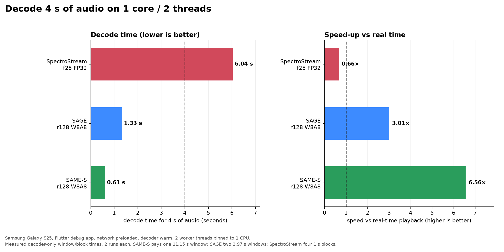
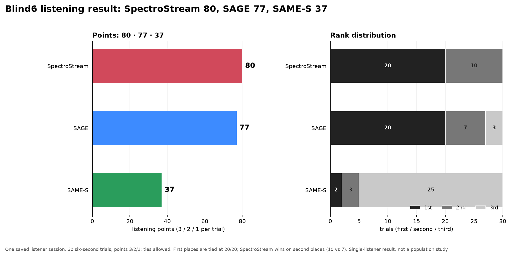

# Neural Audio Codecs on Android

### A practical benchmark and implementation guide for edge music codecs

This repository is a working Android/Flutter benchmark for three neural music
codecs that are relevant to edge playback:

- **SpectroStream** from Google Magenta RealTime — SST tokens → RVQ → TFLite →
  iSTFT;
- **SAGE** — a Swin-V2 audio autoencoder decoded with LiteRT on the CPU;
- **SAME-S** — Stability AI's Stable Audio autoencoder decoded with LiteRT.

It is also a reference implementation: it shows two practical Android decoder
patterns (C ABI + `dart:ffi` and Kotlin + `MethodChannel`/LiteRT), how to package
large models, how to keep decoding off the UI thread, how to measure
time-to-playback correctly, and how to compare quality with objective metrics
and a blind-listening harness.

**Start with the [documentation index](docs/README.md) and the
[Android codec guide](docs/android-codec-guide.md).**

## Results at a glance

### Decode 4 s of audio: 1 core, 2 threads

Measured on a Samsung Galaxy S25, debug app, decoder warm, network already
loaded. This is decoder-only time (no network, no player start):
[full report](docs/decode-4s-2t1c.md).

| Codec | 4 s decoded in | Speed vs real time |
|---|---:|---:|
| **SAME-S** r128 W8A8 | **0.611 s** | **6.5× faster** |
| **SAGE** r128 W8A8 | **1.329 s** | **3.0× faster** |
| **SpectroStream** f25 FP32 | **6.043 s** | **0.66× — slower than real time** |



The numbers are not proportional because the codecs use different window sizes:
SAME-S pays one 11.15 s window, SAGE needs two 2.97 s windows for 4 s, and
SpectroStream needs four 1 s blocks. On one core with two threads,
SpectroStream cannot sustain 4 s of playback; with more threads it can.

### Quality: listener result vs objective metrics

One saved listener session ranked 30 six-second trials (3/2/1 points):

| Place | Codec | Points | 1st / 2nd / 3rd |
|---:|---|---:|---|
| **1** | **SpectroStream** | **80** | 20 / 10 / 0 |
| **2** | **SAGE** | **77** | 20 / 7 / 3 |
| **3** | **SAME-S** | **37** | 2 / 3 / 25 |

First places are tied 20/20; SpectroStream wins on second places. This is one
listener, not a population study.



Objective metrics tell a different story: SAME-S wins SI-SDR and waveform SNR in
all 30 trials, while SpectroStream wins MR-STFT, log-mel, and ICC in all 30.
That waveform-vs-spectral trade-off is exactly why the benchmark reports both
families and a listening result. See [blind6 analysis](docs/blind6-analysis.md).

### Codec profiles

| | SpectroStream f25 | SAGE r128 | SAME-S r128 |
|---|---|---|---|
| Container | `.sst` | `.sage` | `.same` |
| Sample rate | 48 kHz | 44.1 kHz | 44.1 kHz |
| Payload, demo track | 269.5 KB | 172.5 KB | 343.6 KB |
| Bitrate | 16.1 kbit/s | 10.3 kbit/s | 20.6 kbit/s |
| Decoder | C++/FFI, TFLite/XNNPACK, iSTFT | Kotlin, LiteRT, SageDsp | Kotlin, LiteRT |
| Window / block | 1 s | 2.97 s core | 11.15 s |
| Model download | f25 core ~143 MB + codebooks | 59.2 MB | 81.5 MB |
| App-level PSS (S25) | 1 070 MB | 1 120 MB | 608–656 MB |
| Weight license | CC-BY-4.0 (not redistributed) | CC BY-NC-SA 4.0 | Stability AI Community License |

The payload/bitrate values are measured from the checked-in 133.6 s demo. PSS
includes the Flutter process and graphics, not only the decoder.

## How it works

```text
Flutter UI
  ├─ network simulation + asset installer
  ├─ startup timer and HISTORY (up to 40 runs)
  └─ just_audio PCM16 WAV chunk queue
        │
        ├─ SpectroStream: dart:ffi isolate → C++ → TFLite/XNNPACK → iSTFT
        ├─ SAGE:          MethodChannel → Kotlin → LiteRT → SageDsp
        └─ SAME-S:        MethodChannel → Kotlin → LiteRT → PCM
```

The app keeps **one large decoder alive at a time**. Changing mode stops the
current session, releases the inactive decoder, and warms the selected one.

Two integration styles are intentionally included:

| Style | Codec | Use it when |
|---|---|---|
| C ABI + `dart:ffi` | SpectroStream | you already have a C++ decoder/DSP and want native control |
| Kotlin + MethodChannel | SAGE, SAME-S | you use the LiteRT/Java API and want a simple Android library |

## Quick start

```bash
# Runtime decoders (not in Git; verifies SHA-256)
./scripts/fetch_models.sh

# Python encoder / model export environment
cd encoder_service
python3.12 -m venv .venv
source .venv/bin/activate
python -m pip install -r requirements.lock.txt

# C++ decoder (optional; needed for SpectroStream)
cd ../decoder_cpp
mkdir -p build && cd build
cmake .. -DCMAKE_BUILD_TYPE=Release
cmake --build . -j"$(nproc)"

# Flutter client
cd ../../client_android
flutter pub get
flutter analyze
flutter test
flutter build apk --debug
adb install -r -t build/app/outputs/flutter-apk/app-debug.apk
```

The SAGE and SAME-S runtime decoders are downloaded with
`./scripts/fetch_models.sh`; see [model downloads](docs/model-download.md) for
links, sizes, and checksums. The SAME-S demo `.same` is included. The
SpectroStream TFLite/codebooks/window are not in Git; see
[setup](docs/setup.md), [model export](docs/model-export.md), and
[client prerequisites](client_android/README.md).

## Implementation guide

The [Android codec guide](docs/android-codec-guide.md) covers the reusable
patterns in detail:

- choosing FFI vs MethodChannel/LiteRT;
- copying models to app storage and keeping a weight cache;
- one executor/isolate per decoder, never the UI thread;
- CPU affinity and the `THREADS`/`CORES` distinction;
- the PCM → WAV → `just_audio` pipeline;
- why you must not await `just_audio.play()` for a startup metric;
- how window granularity changes “4 s” decode time;
- a step-by-step checklist for adding a fourth codec;
- benchmark protocol and quality evaluation.

Codec-specific material:

- [SpectroStream architecture](decoder_cpp/docs/architecture.md),
  [SST format](decoder_cpp/docs/sst_format.md)
- [SAME-S device report](docs/same-s-device-report.md)
- SAGE decoder/bridge sources:
  `client_android/android/app/src/main/kotlin/com/sagecodec/`

## Benchmark protocol

The app measures:

- **time-to-playback** from Play to the player's `ready`/playing state;
- **network payload** under simulated network profiles;
- **decoder-only time** by summing logged window/block times;
- **process PSS** via `dumpsys meminfo`;
- **quality** with SI-SDR, waveform SNR, MR-STFT, log-mel, ICC, and blind
  listening.

Always state the configuration with a number: device, build type, network
profile, `THREADS`, `CORES`, warm/cold model, and whether the number includes
network or player startup.

Reports:

- [Performance study (Tensor G2)](docs/performance.md)
- [Codec speed matrix (S25)](docs/codec-speed-1c2t.md)
- [4 s decode at 1 core / 2 threads](docs/decode-4s-2t1c.md)
- [4 s decode at default 6 threads](docs/decode-4s.md)
- [Validation: what is and is not verified](docs/validation.md)
- [Raw benchmark data](docs/benchmarks/README.md)

## Repository map

- `encoder_service/` — Python batch encoder and model exporters.
- `decoder_cpp/` — SpectroStream C++ runtime, CLI, C API, tests, Android build.
- `client_android/` — Flutter app, Kotlin bridges, assets, on-device UI.
- `docs/` — setup, implementation guide, model downloads, benchmark reports,
  charts, licenses.
- `scripts/fetch_models.sh` — downloads the two runtime decoders and verifies
  their SHA-256 checksums.
- `media/` — local source media and reference WAVs (not in Git).
- `models/` — cache of source Magenta RealTime SavedModels.
- `decoder_cpp/models/` — exported SpectroStream runtime assets.

## Quality and listening

The saved blind6 session is a single-listener directional result: SpectroStream
80, SAGE 77, SAME-S 37. It is not a population study. The per-track scores are
mixed, and objective waveform/spectral metrics disagree, so treat the ranking as
one data point rather than a universal verdict.

See [blind6 analysis](docs/blind6-analysis.md), the
[listening result](docs/benchmarks/blind6_listening_results.json), and the
[objective summary](docs/benchmarks/blind6_summary.json).

## Contributing

See [CONTRIBUTING.md](CONTRIBUTING.md) for benchmark PR requirements, the
new-codec checklist, and the data/privacy policy.

## Licensing

Original code and documentation are Apache-2.0. Model weights have separate
terms:

- SAGE: CC BY-NC-SA 4.0 — see [WEIGHTS.md](WEIGHTS.md);
- SAME-S: Stability AI Community License — see
  [WEIGHTS.md](WEIGHTS.md) and
  [LICENSES/STABILITY-AI-COMMUNITY-LICENSE.txt](LICENSES/STABILITY-AI-COMMUNITY-LICENSE.txt).
  **Powered by Stability AI.**
- SpectroStream weights are not redistributed here; see
  [THIRD_PARTY_NOTICES.md](THIRD_PARTY_NOTICES.md) and the model-export guide.

The demo track and generated container/audio files are included for
demonstration only. Replace them with content you have the rights to publish if
you fork this repository.
