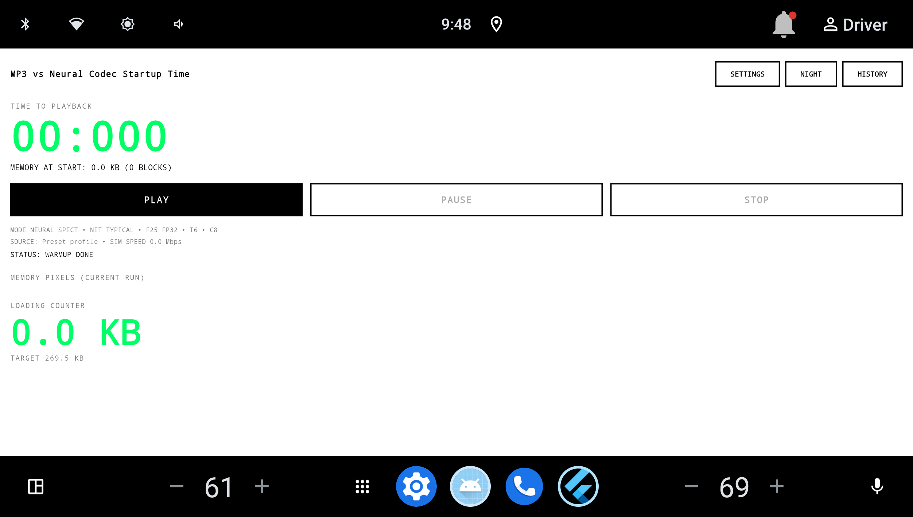
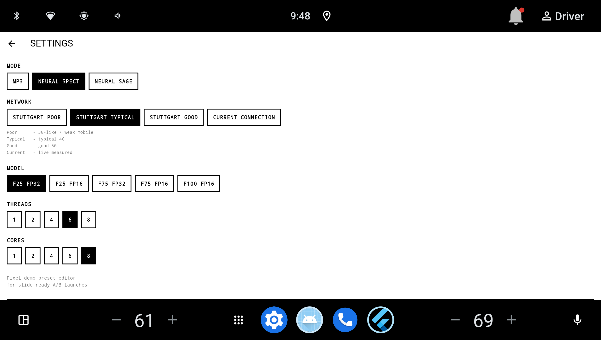
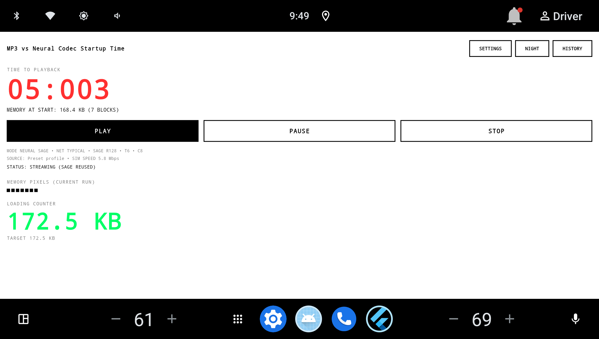
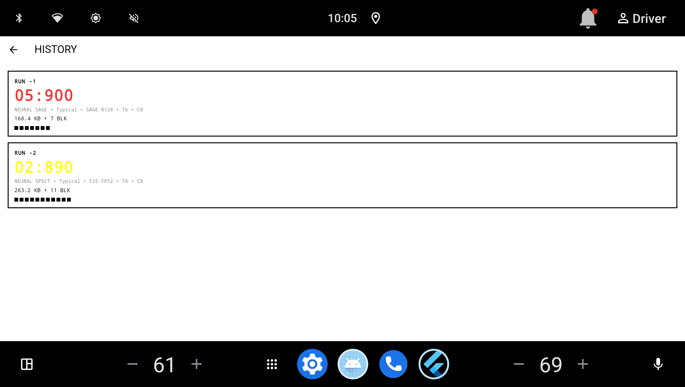

# Neural Codecs

An experiment with neural audio codecs on Android: Google SpectroStream from
Magenta RealTime, SAGE, and Stability AI SAME-S. SpectroStream audio is encoded
into SST tokens and decoded on the CPU; SAGE and SAME-S use their own `.sage` and
`.same` containers and LiteRT decoders. SpectroStream works at 48 kHz stereo;
SAGE and SAME-S at 44.1 kHz. All are lossy: the reconstructed WAV does not match
the original bit-for-bit.

## Getting started

1. [Prepare the environment, dependencies, and source weights](docs/setup.md).
2. [Compress your track and reconstruct it in Python and C++](docs/roundtrip.md).
3. If needed, [export models for C++](docs/model-export.md).
4. For the app, follow the [Flutter/Android instructions](client_android/README.md).
5. Review the [Android performance and resource study](docs/performance.md).

[Validation results](docs/validation.md) distinguish completed scenarios
from steps that have not yet been verified from a clean clone.
There is also a brief entry point for agents: [AGENTS.md](AGENTS.md).

## What the project does

- `encoder_service/batch_encode.py` reads a file or a directory of WAV, MP3,
  FLAC, OGG, Opus, M4A, and AAC files; it uses FFmpeg to convert audio to 48 kHz stereo
  and writes SST, metadata, and a track catalog.
- `--verify-first` enables reference Python decoding of new tracks;
  `--verify-depths` selects RVQ depths 16, 32, and 64.
- The C++ CLI independently reads SST, verifies the CRC, and decodes to PCM16 WAV
  using TFLite/XNNPACK. A C API is available for Flutter FFI and streaming decoding.
- The Flutter app compares MP3, SpectroStream, SAGE, and SAME-S startup time
  across network profiles, model choices, worker threads, and CPU affinity.

SST stores tokens, but not decoder weights. Reconstruction requires a compatible
model, RVQ codebooks, and an iSTFT window. The current encoder stores full q64;
q16/q32 in metadata are transmission estimates, not separately created files.

## Performance snapshot

Measured on an AAOS/Tensor G2 head unit with one generated 133.6 s track. This
is a single-device engineering study, not a universal benchmark. Full method,
tables, and caveats are in [docs/performance.md](docs/performance.md).

| Mode | Payload | Bitrate | RTF / time to playback |
|---|---:|---:|---:|
| MP3 | 5.35 MB | 320 kbit/s | 7.42 s to playback (S25, simulated 6 Mbit/s) |
| SpectroStream f25 | 269.5 KB | 16.1 kbit/s | RTF 1.51 (T6/C8, full track) |
| SAGE r128 | 172.5 KB | 10.3 kbit/s | RTF 0.46 (4 threads); app startup 5.90 s |
| SAME-S r128 | 343.6 KB | 20.6 kbit/s | RTF 0.09 (4 threads, reference); app startup 0.90–1.25 s (S25) |


*The payload figure predates the SAME-S addition; the table above includes its
343.6 KB / 20.6 kbit/s payload.*

SpectroStream thread scaling saturates around four workers on this device;
`CORES` constrains affinity but does not add throughput beyond the useful thread
count. SAGE rung 128 is the better mobile trade-off than rung 256 in both
startup latency and memory. SAME-S has the lowest decode RTF of the three but a
larger payload and model than SAGE; its in-app startup needs a device run.

On a Samsung SM-S931B (Android 15, debug build, T6/C8, Typical 6 Mbit/s) the
corrected app-level startup was 0.971 s for SpectroStream f25, 0.984 s for
SAGE r128, 0.902–1.246 s for SAME-S r128, and 7.422 s for MP3 (full 5.35 MB
download under the simulated 6 Mbit/s profile). The app-level Tensor G2 values in
the table predate the 2026-10-25 startup-metric fix (they included the first
chunk's playback); see [the SAME-S device report](docs/same-s-device-report.md) and the
[1-core / 2-thread codec matrix](docs/codec-speed-1c2t.md).


## App screenshots



*Main screen: live time-to-playback, network profile, mode, model, threads and
cores, plus the square payload visualization.*

| Settings | SAGE streaming | HISTORY |
|---|---|---|
|  |  |  |

The screenshots come from the debug app on the AAOS/Tensor G2 device. The
HISTORY view is filled by real runs; it is not a mock.

SAME-S on-device screenshots: [main screen](docs/images/app-same-s-main.png)
and [HISTORY](docs/images/app-same-s-history.png).

## Structure

- `encoder_service/` — Python encoder and exporters; [CLI options](encoder_service/README.md).
- `decoder_cpp/` — runtime, CLI, C API, tests, and Android scripts;
  [build and CLI](decoder_cpp/README.md), [architecture](decoder_cpp/docs/architecture.md),
  [SST1 format](decoder_cpp/docs/sst_format.md).
- `client_android/` — Flutter client.
- `docs/` — setup, full cycle, export, validation results, benchmarks, and checksums.
- `media/` — source audio, SST, WAV, images, video, and presentation.
- `models/` — cache of the source Magenta SavedModels.
- `decoder_cpp/models/` — exported runtime assets.
- `third_party/`, `decoder_cpp/third_party/` — local external dependencies.

## Which files are in Git

The repository keeps source code, configuration, documentation, tests,
app icons, a small generated demo track, and the SAGE and SAME-S decoder
weights: `client_android/assets/audio/demo.mp3`,
`client_android/assets/spectrostream/demo.sst`,
`client_android/assets/sage/demo.sage`,
`client_android/assets/sage/dec_w8a8.tflite`,
`client_android/assets/same/demo.same`, and
`client_android/assets/same/dec_w8a8_s128.tflite`.

The SAGE weights are distributed under **CC BY-NC-SA 4.0**, and the SAME-S
weights under the **Stability AI Community License**; neither is Apache-2.0.
See [WEIGHTS.md](WEIGHTS.md) for attribution, modifications, checksums, and
scope. SpectroStream weights and exported models **are not stored in Git**: the
source SavedModels are downloaded from Hugging Face, while the TFLite core
models, codebooks, and the iSTFT window are exported according to the
[instructions](docs/model-export.md) or downloaded separately. Links and
checksums are in [models/README.md](models/README.md),
[docs/source-model.sha256](docs/source-model.sha256), and
[docs/runtime-assets.sha256](docs/runtime-assets.sha256).

Media, external checkouts, environments, builds, and prebuilt native libraries
are excluded via `.gitignore`. To encode in a clean clone, install the
dependencies; for Android, also build the native runtime and prepare the
models as described in [setup](docs/setup.md).

```text
media/                      # local experiments, not in Git
├── images/                 # images
├── videos/                 # video and screen recordings
├── presentation/           # slides
├── data/
│   ├── input/              # default encoder input
│   ├── encoded/            # SST, metadata.json, catalog.json
│   └── reconstructed/      # Python reference WAVs
└── reconstructed/
    ├── cpp/                # Linux reference WAVs
    └── android/            # Android reference WAVs
```

The demo track for the app lives directly under `client_android/assets/`; it is
a generated track, not an external symbolic link. Create directories for new
experiments inside `media/`.
Android icons remain in `android/app/src/main/res/`.

## Experiment reports

`decoder_cpp/report.md`, `decoder_cpp/ANDROID_REPORT.md`,
`decoder_cpp/android_build_report.md`,
`decoder_cpp/android/results/ANDROID_DEVICE_REPORT.md`, and
`client_android/client_report.md` describe separate past experiments.
Their limitations and figures may refer to earlier versions;
for current commands, use the guides above and [validation](docs/validation.md).

## License

Original code and documentation in this repository are licensed under the
[Apache License 2.0](LICENSE). The SAGE rung-128 model weights are a separate
work distributed under [CC BY-NC-SA 4.0](LICENSES/CC-BY-NC-SA-4.0.txt), not
Apache-2.0; attribution and modification details are in [WEIGHTS.md](WEIGHTS.md).
The included SAME-S weights are distributed under the
[Stability AI Community License](LICENSES/STABILITY-AI-COMMUNITY-LICENSE.txt),
also not Apache-2.0; see [WEIGHTS.md](WEIGHTS.md) and
[assets/same/README.md](client_android/assets/same/README.md).
The demo track is a generated asset included for demonstration. SpectroStream
weights are not redistributed here; see [THIRD_PARTY_NOTICES.md](THIRD_PARTY_NOTICES.md)
for upstream attribution and model terms.
