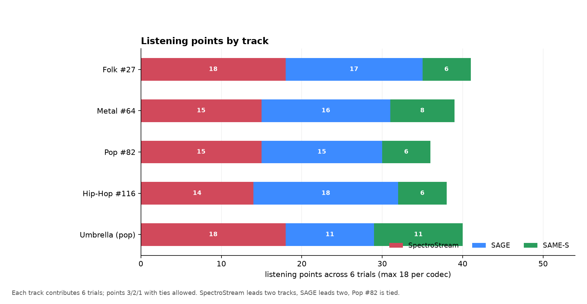
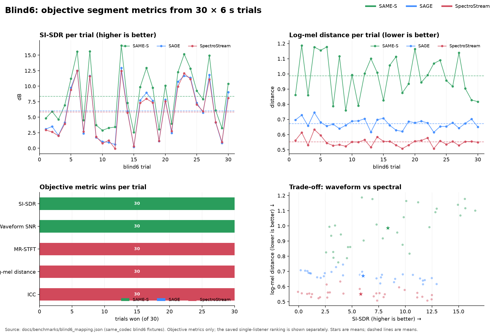

# Blind6: listening result and objective quality

`blind6` is the six-second, 30-trial listening fixture for the three codecs. It
contains five tracks × six segments and six shuffled A/B/C label orders. The
repository copy of the trial mapping is
[benchmarks/blind6_mapping.json](benchmarks/blind6_mapping.json); the saved
single-listener ranking is
[benchmarks/blind6_listening_results.json](benchmarks/blind6_listening_results.json).

## Listening result

One saved listener session completed all 30 trials. The ranking gives 3 points
for first place, 2 for second, and 1 for third; ties are allowed and an unmarked
variant is third.

| Place | Codec | 1st | 2nd | 3rd | Points | Avg rank |
|---:|---|---:|---:|---:|---:|---:|
| **1** | **SpectroStream** f25 FP32 | 20 | 10 | 0 | **80** | 1.333 |
| **2** | **SAGE** r128 W8A8 | 20 | 7 | 3 | **77** | 1.433 |
| **3** | **SAME-S** r128 W8A8 | 2 | 3 | 25 | **37** | 2.767 |

First places are tied at 20/20; **SpectroStream wins on second places (10 vs 7)**
and therefore on total points, 80 to 77. SAME-S is third with 37 points.


This is a **single-listener** result from one session, not a controlled
multi-listener study. It is useful as a directional signal and as a reproducible
example of the scoring protocol, not as a population estimate. The raw session
metadata (browser, timezone, page URL) was removed from the checked-in JSON.

### Points by track

Six trials per track; maximum 18 points per codec per track:

| Track | SpectroStream | SAGE | SAME-S |
|---|---:|---:|---:|
| Umbrella (pop) | **18** | 11 | 11 |
| Folk #27 | **18** | 17 | 6 |
| Metal #64 | 15 | **16** | 8 |
| Pop #82 | **15** | **15** | 6 |
| Hip-Hop #116 | 14 | **18** | 6 |



SpectroStream leads Umbrella and Folk; SAGE leads Metal and Hip-Hop; Pop #82 is
tied. The overall ranking is close (80 vs 77), and the per-track result is
mixed — a useful reminder that the aggregate score hides content dependence.

## Objective quality

Mean values over the same 30 trials:

| Codec | SI-SDR ↑ | Waveform SNR ↑ | MR-STFT ↓ | Log-mel ↓ | ICC ↑ |
|---|---:|---:|---:|---:|---:|
| **SAME-S** | **8.36 dB** | **8.96 dB** | 1.333 | 0.987 | 0.882 |
| **SAGE** | 6.03 dB | 6.98 dB | 1.038 | 0.672 | 0.880 |
| **SpectroStream** | 5.82 dB | 6.79 dB | **0.971** | **0.552** | **0.914** |

Per-trial wins (best value in each trial):

| Metric | SAME-S | SAGE | SpectroStream |
|---|---:|---:|---:|
| SI-SDR | **30** | 0 | 0 |
| Waveform SNR | **30** | 0 | 0 |
| MR-STFT | 0 | 0 | **30** |
| Log-mel | 0 | 0 | **30** |
| ICC | 0 | 0 | **30** |



The objective metrics split cleanly: SAME-S wins waveform fidelity in every
trial, SpectroStream wins the spectral/perceptual metrics in every trial, and
SAGE is generally between or below them. This is the central quality trade-off.

## What the combination shows

- **Listening:** SpectroStream 80, SAGE 77, SAME-S 37 (one listener).
- **Objective waveform:** SAME-S is best by a wide margin.
- **Objective spectral/perceptual:** SpectroStream is best by a wide margin.

The listener result does **not** follow SI-SDR: SAME-S has the highest waveform
SNR but is last in the ranking. It follows the spectral/perceptual side more
closely. That is exactly why a benchmark should report both families of metrics
and a listening result, not a single “winner” metric.

## Reproduce

```bash
uv run --with matplotlib python docs/benchmarks/plot_blind6.py
```

The script regenerates:

- `docs/images/blind6-listening-results.png`
- `docs/images/blind6-points-by-track.png`
- `docs/images/blind6-overview.png`
- `docs/images/blind6-metric-wins.png`
- `docs/images/blind6-distributions.png`

Raw computed objective summary:
[benchmarks/blind6_summary.json](benchmarks/blind6_summary.json).

## Adding more listeners

The blind page can export more sessions. A multi-listener analysis should
aggregate first/second/third counts and points across sessions, report the number
of listeners and confidence intervals, and keep the per-track breakdown. The
current checked-in data is one session; do not present it as a population study.
