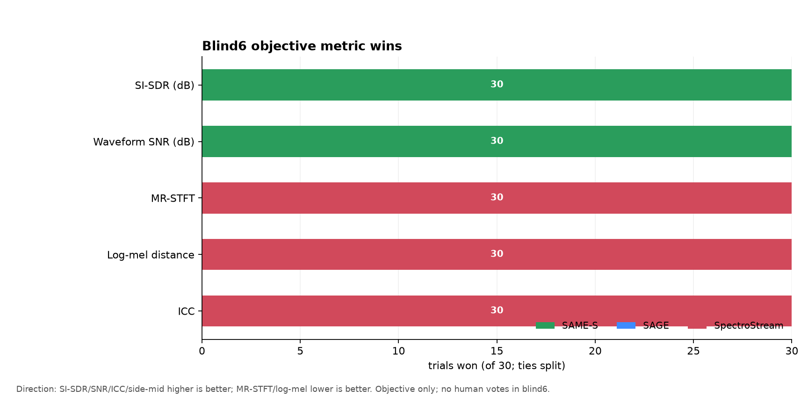
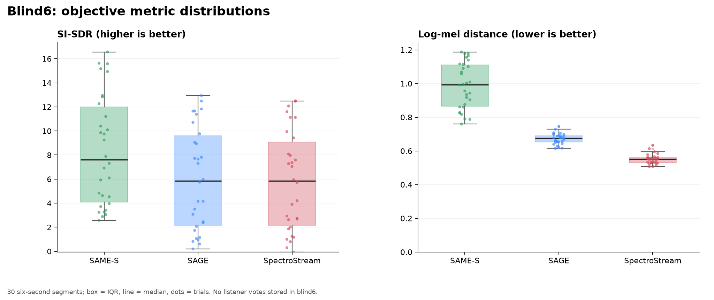

# Blind6: objective quality of the three codecs

`blind6` is the six-second, 30-trial listening fixture from the SAME-S project.
It contains five tracks × six segments and six shuffled A/B/C label orders. The
repository copy of the data is
[benchmarks/blind6_mapping.json](benchmarks/blind6_mapping.json).

**Important:** the `blind6` directory contains the trial mapping and the
per-segment objective metrics, but **no saved listener votes/rankings**. The
HTML player stores rankings in browser `localStorage` under
`samecodec.blindtest.saves.v2`; that export was not present in the artifact
directory. The charts below therefore show **objective quality**, not human
preference. If you export the saved rankings, the same data can be extended with
preference plots.

## Objective metrics

Mean values over 30 trials:

| Codec | SI-SDR ↑ | Waveform SNR ↑ | MR-STFT ↓ | Log-mel ↓ | ICC ↑ |
|---|---:|---:|---:|---:|---:|
| **SAME-S** r128 W8A8 | **8.36 dB** | **8.96 dB** | 1.333 | 0.987 | 0.882 |
| **SAGE** r128 W8A8 | 6.03 dB | 6.98 dB | 1.038 | 0.672 | 0.880 |
| **SpectroStream** f25 FP32 | 5.82 dB | 6.79 dB | **0.971** | **0.552** | **0.914** |

Medians show the same order: SAME-S 7.60 dB SI-SDR, SAGE 5.85 dB,
SpectroStream 5.84 dB. For MR-STFT/log-mel lower is better; for SI-SDR,
waveform SNR and ICC higher is better.

Per-trial wins (best value in each 6 s trial; 30 trials):

| Metric | SAME-S | SAGE | SpectroStream |
|---|---:|---:|---:|
| SI-SDR | **30** | 0 | 0 |
| Waveform SNR | **30** | 0 | 0 |
| MR-STFT | 0 | 0 | **30** |
| Log-mel | 0 | 0 | **30** |
| ICC | 0 | 0 | **30** |

This is the central quality trade-off: **SAME-S wins waveform fidelity,
SpectroStream wins spectral/perceptual similarity, and SAGE is generally
between or below them on these metrics.** The metrics disagree, which is exactly
why a blind listening test is needed for a product decision.

## Charts


- Top-left: per-trial SI-SDR; SAME-S is consistently highest.
- Top-right: per-trial log-mel distance; SpectroStream is consistently lowest.
- Bottom-left: metric wins; the 30/30 split between waveform and spectral
  metrics.
- Bottom-right: trade-off scatter; stars are means.





The charts are generated from the checked-in JSON by
[benchmarks/plot_blind6.py](benchmarks/plot_blind6.py):

```bash
uv run --with matplotlib python docs/benchmarks/plot_blind6.py
```

## What the blind test was designed to measure

- 30 trials, each 6 s long, from five tracks (pop, hip-hop, metal, folk, pop).
- Each trial has three encoded variants plus the reference; labels A/B/C are
  shuffled, and all six label permutations occur five times.
- The intended UI is a ranking (`1st`, `2nd`, or unmarked = `3rd`), but the
  saved rankings are not part of the artifact.

## How to add human preference charts

Export the rankings from the blind page (Save button / localStorage) and add a
`rankings` array keyed by trial and label. The plotting script can then show:

- first-place counts per codec;
- mean rank / Borda score per codec;
- preference by track and by metric (SI-SDR, log-mel, etc.).

Without those votes, any "winner" claim would be objective-only. The current
evidence supports a **trade-off**, not a single winner.

Raw summary: [benchmarks/blind6_summary.json](benchmarks/blind6_summary.json).
