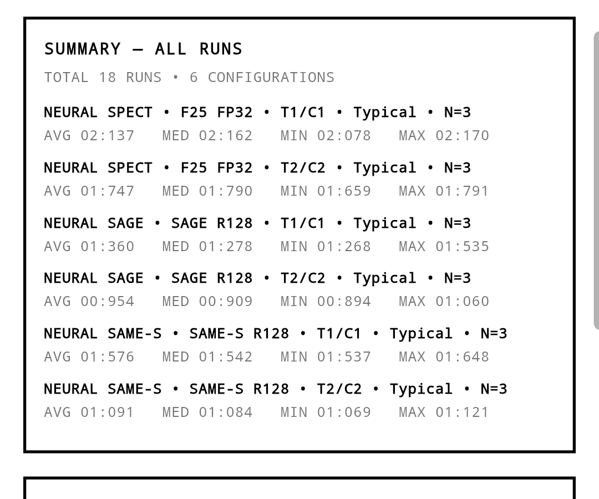

# Codec startup speed: 1 core vs 2 threads

Date: 2026-10-25. Device: Samsung Galaxy S25 (`SM-S931B`), Android 15,
arm64-v8a, 8 cores, 11.4 GB RAM. Debug Flutter build 1.0.0.

Goal: compare the three neural codecs at the same network profile and CPU
limits:

- **T1/C1** — one LiteRT/XNNPACK worker thread, affinity to one CPU;
- **T2/C2** — two worker threads, affinity to two CPUs.

The app's `THREADS` is the worker count; `CORES` pins the decoder thread and
its workers. This matrix does **not** include T2/C1 (2 threads on 1 core); that
requested configuration was measured separately in
[decode-4s-2t1c.md](decode-4s-2t1c.md). Both runs here use the same `Typical` profile (simulated 6 Mbit/s) and
three repeats per codec/configuration. Each codec was warmed up before its
first measured run; the device process was restarted first, so the in-memory
HISTORY contained exactly these 18 runs.

## Results

Time to playback, milliseconds. “Avg” is the arithmetic mean of three runs;
the range is min–max.

| Codec | T1/C1 runs | T1/C1 avg | T2/C2 runs | T2/C2 avg | 1→2 speedup |
|---|---|---:|---|---:|---:|
| SpectroStream f25 FP32 | 2078, 2162, 2170 | **2136.7** | 1659, 1791, 1790 | **1746.7** | 1.22× |
| SAGE r128 W8A8 | 1535, 1278, 1268 | **1360.3** | 1060, 894, 909 | **954.3** | 1.43× |
| SAME-S r128 W8A8 | 1648, 1537, 1542 | **1575.7** | 1121, 1069, 1084 | **1091.3** | 1.44× |

Medians (less sensitive to the first-run warm-up outlier):

| Codec | T1/C1 median | T2/C2 median |
|---|---:|---:|
| SpectroStream f25 | 2162 ms | 1790 ms |
| SAGE r128 | 1278 ms | 909 ms |
| SAME-S r128 | 1542 ms | 1084 ms |

Observations:

- At one core, **SAGE is fastest** (1.36 s avg), SAME-S is second (1.58 s), and
  SpectroStream is slowest (2.14 s).
- At two threads, the order is the same: **SAGE 0.95 s**, **SAME-S 1.09 s**,
  **SpectroStream 1.75 s**.
- SAME-S is ~16% slower than SAGE at T1/C1 and ~14% slower at T2/C2 in this
  time-to-playback metric.
- SpectroStream gains the least from the second thread (1.22×); SAGE and
  SAME-S gain about 1.43–1.44×.
- The first run of each configuration tends to be slower (SAGE T1 first run
  1.535 s vs 1.27 s later; SAME-S T1 1.648 s vs 1.54 s later), hence the median
  column.

## What the number includes

This is the app's **time to playback**, not pure inference time. It includes:

1. the simulated download of the whole container (Typical 6 Mbit/s):
   SpectroStream 269.5 KB, SAGE 172.5 KB, SAME-S 343.6 KB;
2. first-window/first-block neural decode;
3. writing the first PCM WAV and waiting for `just_audio` to be playing and
   ready.

The payload sizes differ, so SAME-S pays roughly 0.23 s more simulated network
time than SAGE and 0.1 s more than SpectroStream. That does not explain the
whole gap, but it is part of the measurement. The app-level HISTORY is the
source of truth for this comparison; it does not expose a pure decode RTF for
SAGE/SpectroStream.

## Screenshots

The HISTORY screen now keeps up to 40 runs and starts with a summary of all
runs grouped by codec, model, thread/core configuration, and network profile.



Full history pages:

- [Page 1 — summary and newest runs](images/codec-speed-history-1.png)
- [Page 2](images/codec-speed-history-2.png)
- [Page 3](images/codec-speed-history-3.png)
- [Page 4](images/codec-speed-history-4.png)
- [Page 5 — oldest runs](images/codec-speed-history-5.png)

The summary block reports `AVG / MED / MIN / MAX` for each configuration; the
cards below it show every individual run with its mode, model, `T`/`C`, and
payload.

## Reproduce

```bash
cd client_android
flutter build apk --debug --no-pub
adb install -r -t build/app/outputs/flutter-apk/app-debug.apk
adb shell am force-stop com.neuralcodecs.client_android
adb shell am start -n com.neuralcodecs.client_android/.MainActivity
# Settings:
#   mode = NEURAL SPECT / NEURAL SAGE / NEURAL SAME-S
#   network = STUTTGART TYPICAL
#   threads = 1, cores = 1  (then threads = 2, cores = 2)
#   APPLY, wait for WARMUP DONE, PLAY; read HISTORY
```

Raw values: [benchmarks/codec_speed_1c2t_sm_s931b.json](benchmarks/codec_speed_1c2t_sm_s931b.json).
The matrix was driven through the app UI; the recorded numbers are the values
shown in HISTORY (also emitted as `[run]` debug logs).

## Limitations

- Single device, debug build, USB powered; no release/AOT, thermal soak,
  battery, or low-end SoC.
- Three repeats per cell; first-run effects remain visible.
- No MP3 row in this matrix; MP3 is network-dominated at this profile.
- No acoustic verification or quality metrics; this is a startup benchmark.
