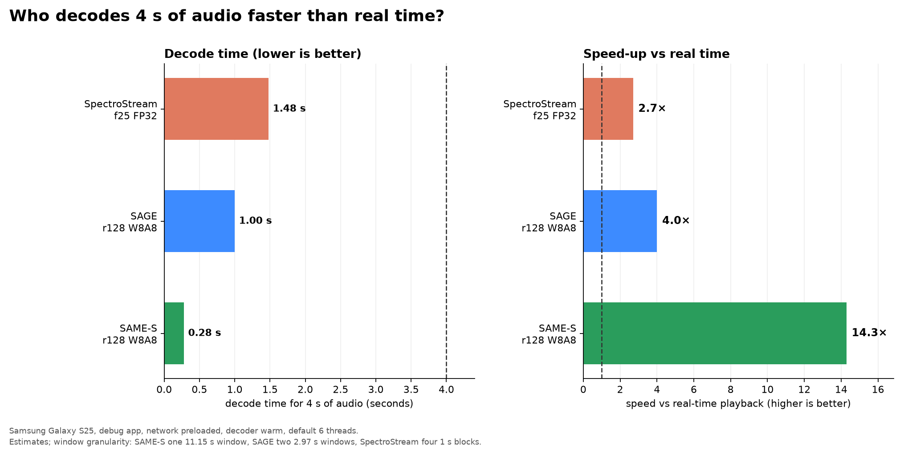

# Decode 4 s of audio: speed vs real time

For the requested **2 threads pinned to 1 core** configuration, see
[decode-4s-2t1c.md](decode-4s-2t1c.md). The numbers below are the default
6-thread/all-core setting.

Slide-ready summary. Conditions: Samsung Galaxy S25, Flutter debug app already
running, network payload already loaded, decoder warm, default app setting
(6 threads / all cores). No network wait, no app launch.

| Codec | Decode 4 s in | Speed vs real time |
|---|---:|---:|
| **SAME-S** r128 W8A8 | **≈0.28 s** | **≈14× faster** |
| **SAGE** r128 W8A8 | **≈1.0 s** | **≈4× faster** |
| **SpectroStream** f25 FP32 | **≈1.5 s** | **≈2.7× faster** |

All three are faster than real time: 4 s of audio is decoded in less than 4 s.

## Why SAME-S wins for a 4-second request

The codecs have different window granularity, so “4 s” is not a proportional
cost:

- SAME-S decodes one 11.15 s window (rung 128); 4 s already fits in that one
  window. The measured window time is about 0.25–0.30 s.
- SAGE decodes core windows of 2.97 s; 4 s needs **two** windows, so it pays for
  about 5.94 s of audio (≈1.0 s).
- SpectroStream decodes 1 s blocks; 4 s needs **four** blocks (≈1.5 s).

This is a granularity effect, not a quality or bitrate comparison.

## What is not included

- Network transfer and app/model startup are excluded.
- Player start (`just_audio` ready) is excluded from the decode numbers above.
- Time to the **first sound** is shorter and similar for all three (~0.5–0.7 s
  at the default setting); the table is about producing all 4 s of PCM.
- SAME-S/SAGE window times are measured on T6/C8; SAGE/SpectroStream 4 s values
  are estimates from `time-to-playback` minus simulated network and player
  start. The device was disconnected before a separate decode-only run, so
  treat these as engineering estimates with ~±15–20% uncertainty.

Raw startup matrix: [codec-speed-1c2t.md](codec-speed-1c2t.md),
[benchmarks/codec_speed_1c2t_sm_s931b.json](benchmarks/codec_speed_1c2t_sm_s931b.json).
