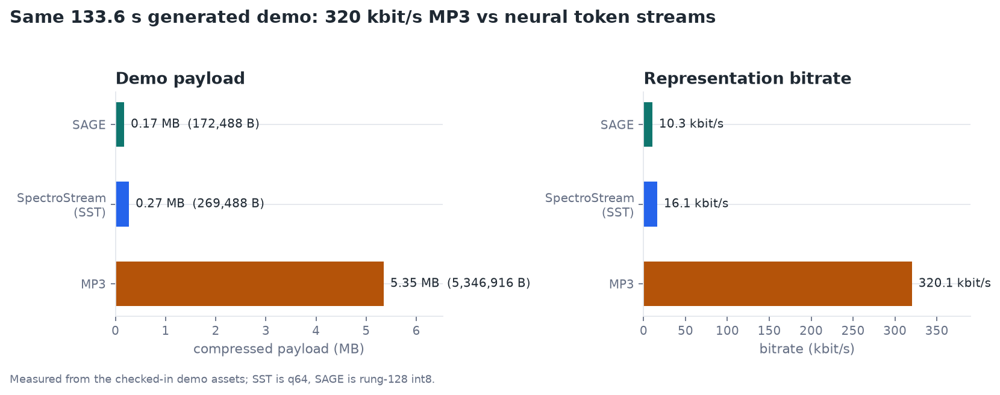
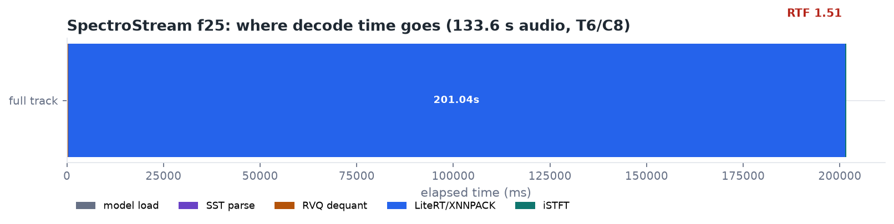
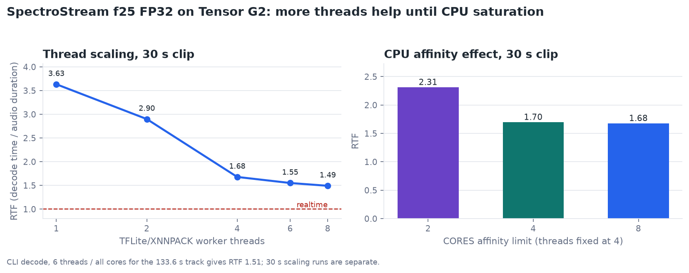
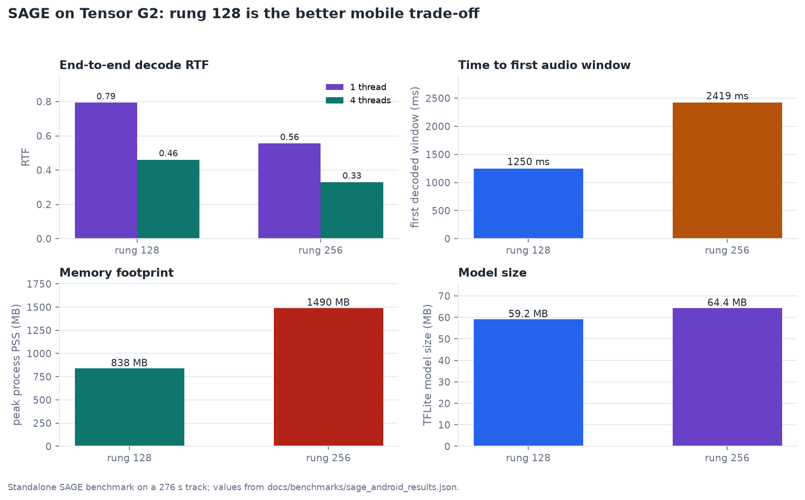
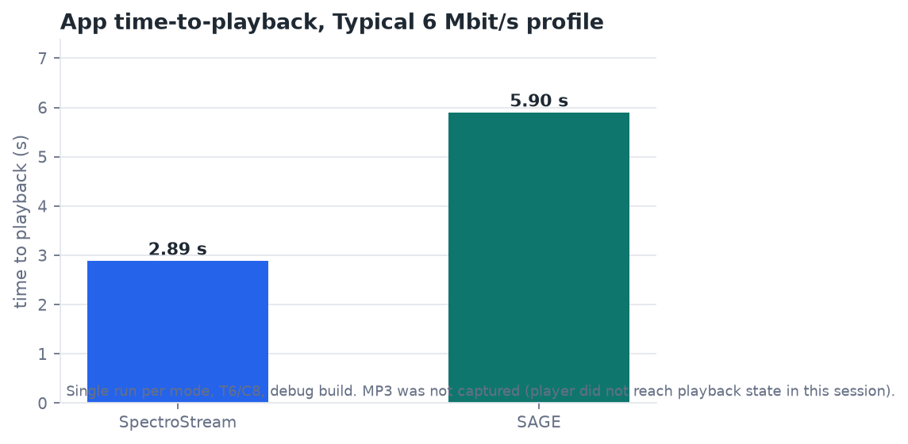
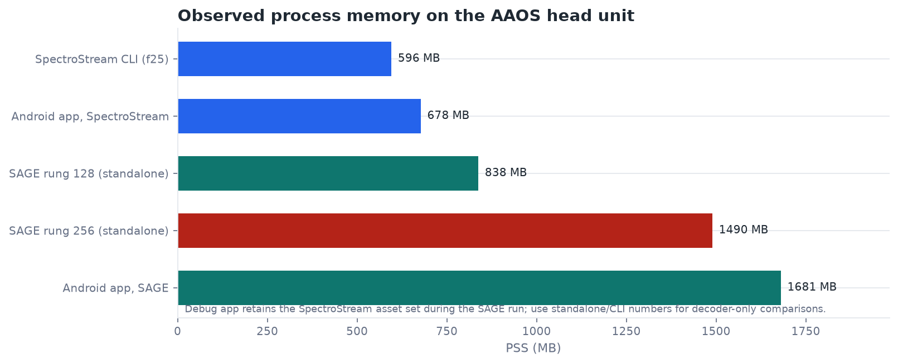

# Performance and Resource Use on Android

This page collects the measurements behind the performance figures. It is a
single-device, single-track engineering study, not a product benchmark or a
battery-life claim.

## Test setup

| Item | Value |
|---|---|
| Device | AAOS on Tangorpro |
| SoC | Google Tensor G2 (`GS201`) |
| CPU | 8 cores, arm64-v8a |
| RAM | 7.6 GB total |
| Android | 15 / API 35 |
| App | Flutter debug build |
| SpectroStream | f25 FP32, TFLite 2.18 + XNNPACK, 64-layer RVQ |
| SAGE | `SAGE_FTe992`, LiteRT 2.3.0, int8 rung 128/256, sliced post-net |
| Demo | one generated track, 133.6 s, 48 kHz stereo |

The checked-in demo is intentionally small: the MP3 is 5.35 MB at 320 kbit/s,
the SpectroStream SST is 269.5 KB, and the SAGE container is 172.5 KB. All three
come from the same generated source track.



## SpectroStream

### Full-track decode

Command:

```bash
adb shell 'cd /data/local/tmp/sscbench && LD_LIBRARY_PATH=. ./spectrostream_decode \
  --model spectrostream_decoder_core_fp32_f25.tflite \
  --codebooks rvq_codebooks.f32 \
  --window istft_window_f960.f32 \
  --input demo.sst --output out.wav --threads 6 --cores 8'
```

| Stage | Time |
|---|---:|
| Model + assets load | 193.0 ms |
| SST parse | 2.6 ms |
| RVQ dequantization | 96.6 ms |
| LiteRT/XNNPACK inference | 201 036.9 ms |
| iSTFT | 336.1 ms |
| **Total decode** | **201 554.0 ms** |
| Audio duration | 133.608 s |
| **RTF** | **1.5086** |

Inference dominates: the iSTFT and container work together are under 0.5 s.
On this AAOS/Tensor G2 unit, f25 at T6/C8 is slower than real time. A previous
Galaxy S24/Exynos 2400 report measured RTF 0.79 for the same model and thread
count. The difference is a device/thermal/AAOS effect, not a claim that one
result generalizes; see the historical report for the S24 context.



### Thread and affinity scaling

A 30 s excerpt was used for the scaling runs so the experiment could finish in a
reasonable time. `THREADS` is the TFLite/XNNPACK worker count. `CORES` limits the
CPU affinity of the decoder thread and the workers it creates; it does not
reserve cores.

| Threads | Cores | RTF | Total decode |
|---:|---:|---:|---:|
| 1 | 8 | 3.6335 | 109 004.9 ms |
| 2 | 8 | 2.8996 | 86 988.2 ms |
| 4 | 8 | 1.6789 | 50 368.3 ms |
| 6 | 8 | 1.5514 | 46 542.6 ms |
| 8 | 8 | 1.4924 | 44 771.5 ms |

| Threads | Cores | RTF | Total decode |
|---:|---:|---:|---:|
| 4 | 2 | 2.3137 | 69 411.9 ms |
| 4 | 4 | 1.6985 | 50 956.0 ms |
| 4 | 8 | 1.6789 | 50 368.3 ms |



Observations:

- Going from 1 to 8 threads improves RTF by about **2.4×**, but most of the
  gain is already at 4 threads. T6 and T8 add little.
- At a fixed 4 threads, limiting affinity to 2 CPUs costs about **38%** RTF
  (2.31 vs 1.68). Going from 4 to 8 allowed CPUs gives almost no additional
  benefit, which is consistent with 4 worker threads saturating the useful
  compute.
- `THREADS` and `CORES` are therefore complementary controls: one sets the
  worker pool, the other constrains where it may run. Neither is a reservation.

## SAGE

SAGE was measured separately with the standalone SAGE player on a 276 s track.
RTF and memory are normalized/independent of the track duration; first-window
latency is the startup-relevant number.

| Setting | Threads | RTF | RTF, model only | First window | PSS | Model |
|---|---:|---:|---:|---:|---:|---:|
| rung 128 | 4 | 0.4608 | 0.3226 | 1249.5 ms | 838 MB | 59.2 MB |
| rung 256 | 4 | 0.3303 | 0.2158 | 2419.4 ms | 1490 MB | 64.4 MB |
| rung 128 | 1 | 0.7931 | 0.6890 | 2178.5 ms | — | — |
| rung 256 | 1 | 0.5553 | 0.4517 | 4315.0 ms | — | — |



Rung 128 is the better mobile trade-off: it is still faster than real time at
4 threads, starts producing audio roughly twice as fast, and uses much less
memory than rung 256. Rung 256 has a higher reconstruction ceiling but pays for
it in startup latency and activation memory.

## App-level startup and memory

The app was exercised on the same generated demo. The in-app HISTORY screen
recorded:

| Mode | Time to playback | Process PSS |
|---|---:|---:|
| SpectroStream | 2.890 s | 677.5 MB |
| SAGE | 5.900 s | 1681 MB |
| MP3 | not captured | — |

Both runs used the Typical 6 Mbit/s profile, T6/C8, debug build. The SAGE
process still retained the SpectroStream asset set; the app-level SAGE PSS is
therefore not a decoder-only number. Use the standalone/CLI values for
decoder-to-decoder comparisons.



The MP3 player did not reach a playback state during the measurement session,
so no MP3 startup number is reported. This is a limitation of the debug/AAOS
run, not a measured advantage for the neural modes. Payload and bitrate for MP3
are still measured directly from the checked-in file.

## Memory comparison



The SpectroStream CLI (f25 + codebooks, one decode) has a PSS of about 596 MB.
The debug app is larger because it installs and keeps several model variants.
SAGE rung 128 is around 838 MB standalone; rung 256 grows to 1490 MB. These
numbers are dominated by model weights and XNNPACK/LiteRT activation arenas,
not by the container itself.

## What this does and does not show

What it shows:

- Neural token streams are 20–31× smaller than the 320 kbit/s MP3 for this
  track.
- SpectroStream f25 is not real-time on this AAOS/Tensor G2 unit at T6/C8;
  thread scaling saturates around 4 threads.
- SAGE rung 128 decodes faster than real time at 4 threads and is the better
  memory/startup choice than rung 256.
- CPU affinity is useful for constraining the decoder, but `CORES` is not a
  performance multiplier beyond the useful thread count.

What it does not show:

- No battery, thermal-soak, low-end-SoC, or GPU/NPU measurements.
- One device and one track; no statistical repeats.
- The app is a debug build; release AOT and a release asset set may differ.
- SAGE numbers come from a different track length (276 s), though RTF and
  first-window latency are normalized.
- MP3 startup was not captured in this session.

## Reproduce

The raw values are in [benchmarks/measurements.json](benchmarks/measurements.json).
The figures can be regenerated with:

```bash
uv run --with matplotlib python docs/benchmarks/plot_benchmarks.py
```

The SpectroStream CLI benchmark requires the local exported models. Use the
commands in [benchmarks/README.md](benchmarks/README.md), or run the app on a
device and read the HISTORY screen. Model assets are intentionally not stored
in Git; see [models/README.md](../models/README.md).
