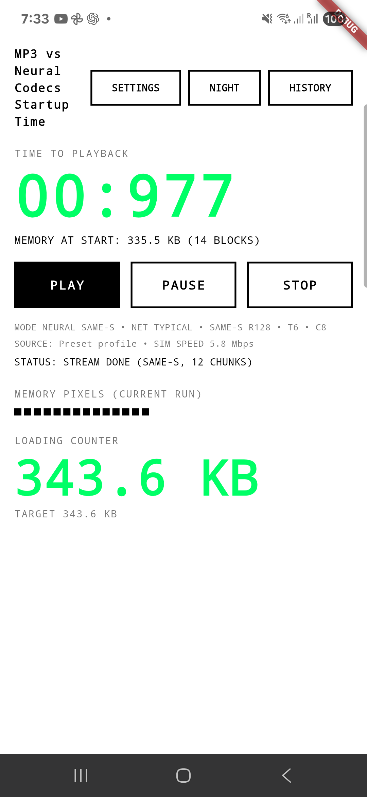
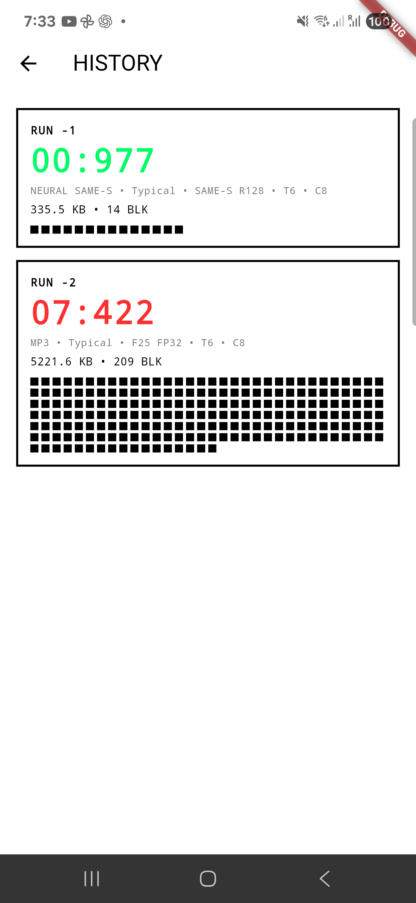

# SAME-S on-device report — Samsung SM-S931B

Date: 2026-10-25. Scope: the fourth mode, `NEURAL SAME-S`, in the Flutter
client, after adding the SAME-S assets and Kotlin bridge.

## Device and build

| Item | Value |
|---|---|
| Device | Samsung Galaxy S25 (`SM-S931B`, `pa1q`) |
| OS | Android 15 / API 35 |
| ABI | arm64-v8a |
| CPU | 8 cores |
| RAM | 11,385,684 kB |
| Display | 1080 × 2340, density 420 |
| Power | USB powered |
| App | Flutter debug build, version 1.0.0 |
| Threads / cores | T6 / C8 |
| Network profile | Stuttgart Typical, simulated 6 Mbit/s |
| Demo | 133.6 s; 5,892,096 samples at 44.1 kHz |
| SAME-S | W8A8 `dec_w8a8_s128.tflite`, rung 128, trim 8, `CompiledModel` |

## Result

| Mode | Time to playback | Process PSS |
|---|---:|---:|
| SpectroStream f25 FP32 | 0.971 s | 1,069.8 MB |
| SAGE r128 W8A8 | 0.984 s | 1,119.6 MB |
| SAME-S r128 W8A8 | 0.902–1.246 s (5 runs; median 0.977 s) | 608–656 MB |
| MP3 | 7.422 s | not measured |

SAME-S individual runs: 1.055 s (first after launch), 0.907 s, 0.902 s,
1.246 s (later mode-switch run), and 0.977 s (final run). The first run
includes the first player initialization; later runs reuse the loaded decoder.

The SAME-S PSS was 608 MB with the decoder loaded and HISTORY open, 640–656 MB
after later runs, and **429 MB after switching from SpectroStream back to
SAME-S** (the SpectroStream native decoder had been released). The process PSS
includes Flutter, graphics, and the installed asset cache; it is not a
decoder-only number.





## Startup-measurement fix

While testing SAME-S we found a pre-existing measurement bug:
`AudioPlayerService` awaited `just_audio`'s `play()` future. That future
completes when playback **finishes or pauses**, not when audio starts. As a
result, the “time to playback” included the entire first chunk:

- SAME-S first chunk is 491,520 frames (11.15 s), so the old code reported
  about 12.0 s even though AudioTrack started about 1 s after Play.
- SAGE's first chunk is 131,072 frames (2.97 s), so the old code reported about
  4.1 s.
- The old Tensor G2 app-level values (2.89 s / 5.90 s) were measured with the
  old wait and include at least the first chunk duration plus player overhead;
  they are historical and not directly comparable with the table above.

Fix applied in `client_android/lib/services/audio_player_service.dart`:

- `play()` and `resume()` are no longer awaited; the returned future is
  intentionally not awaited.
- `waitForPlaybackStart()` waits for `PlayerState.playing` with
  `ProcessingState.ready` (or `completed`) instead of `position > 0`.

This is an app-wide metric fix; it affects MP3, SpectroStream, SAGE, and
SAME-S. MP3 now reaches the captured state at 7.422 s (the 5.35 MB asset is
downloaded in full under the Typical 6 Mbit/s simulation). Its status label was
left at `PREPARING` because the MP3 branch did not update it; that cosmetic bug
was fixed to show `STREAMING (MP3)`.

## SAME-S decode

Logs from the last run:

| Stage | Value |
|---|---|
| Decoder init | 81,517,872 B model, `rungs=[128]` |
| CPU affinity | `affinity(8) -> 0` |
| Windows | 13 / 13 |
| First chunk | 491,520 frames per channel, 248–305 ms |
| Middle chunks | 458,752 frames, 244–278 ms |
| Final chunk | 354,304 frames (trimmed to `orig_samples`) |
| Total PCM | exactly 5,892,096 frames per channel |
| Decode time (sum of windows) | ~3.3 s for 133.6 s audio |
| Decode RTF | ~0.025–0.030 |
| Audio output | `AudioTrack` initialized; chunks delivered by ExoPlayer |

The 13 windows are the expected partition for 1,440 stored latent frames with
rung 128 and trim 8. The final chunk is trimmed to the container’s
`orig_samples`; no duplicated or missing samples were observed in the logs.

## What was verified

- Settings shows `MP3`, `NEURAL SPECT`, `NEURAL SAGE`, `NEURAL SAME-S`; the
  SAME-S model row is fixed to `SAME-S W8A8 R128`.
- Selecting SAME-S loads `same_xnnwc_81517872.bin` and initializes the LiteRT
  `CompiledModel` with one rung (`s128`).
- Playback starts, all 13 chunks decode, and the UI reaches
  `STREAM DONE (SAME-S, 12 CHUNKS)`.
- HISTORY records SAME-S runs with the correct mode/model label and bytes.
- Switching SAME-S → SAGE → SpectroStream → SAME-S did not crash; releasing the
  previous decoder reduced PSS from ~1.07 GB to ~0.43 GB.
- `flutter analyze --no-pub` and `flutter test --no-pub` pass; the debug APK
  builds and installs.

## What was not verified

- Acoustic output with a microphone/listener; only AudioTrack delivery and
  player state were observed.
- Android-vs-Python PCM comparison for this integration, and subjective audio
  quality. SAME-S is a generative autoencoder; quality is not the goal of this
  startup test bed.
- Battery/energy, thermal soak, long runs, release builds, and low-end SoCs.
- MP3 PSS and a separate MP3 quality check.

## Reproduce

```bash
cd client_android
flutter build apk --debug --no-pub
adb install -r -t build/app/outputs/flutter-apk/app-debug.apk
adb shell am start -n com.neuralcodecs.client_android/.MainActivity
# Settings -> NEURAL SAME-S -> APPLY -> PLAY
adb logcat -s SameBridge flutter
adb shell dumpsys meminfo com.neuralcodecs.client_android
```

Raw values: [benchmarks/same_s_sm_s931b.json](benchmarks/same_s_sm_s931b.json).
Multi-configuration (1 core vs 2 threads, all three codecs):
[codec-speed-1c2t.md](codec-speed-1c2t.md).
